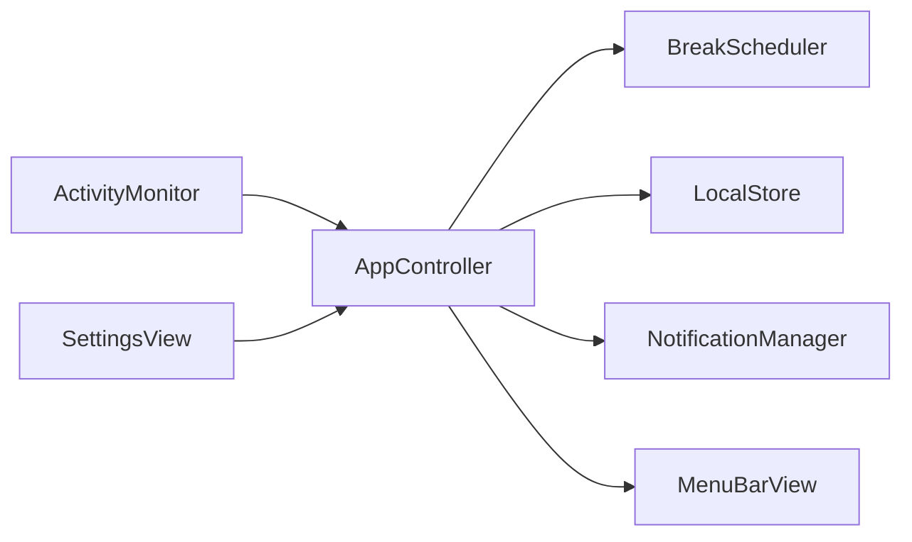

# Kıpır — Architecture

## Boundaries
`BreakScheduler` is the sole authority: Foundation only, injected monotonic seconds, date and aggregate idle seconds, no timers or permissions. `Settings` validates preferences. `LocalStore` serializes validated checkpoints and current-day totals to UserDefaults. `AppController` is main-actor isolated, owns the only heartbeat, publishes a snapshot and dispatches actions. `ActivityMonitor` reads CoreGraphics aggregate idle and lifecycle notifications. `NotificationManager` owns permission/category/delivery and rejects stale identifiers. SwiftUI renders state and calls the controller.

## State machine
Working transitions to Due at its confirmed work target; Due transitions to Break, snoozed Working, or skipped Working. Break completion returns to Working and increments the completed cycle. Pause and Meeting are orthogonal overrides that preserve phase/countdown but freeze all accounting and suppress reminders. Lifecycle suspension freezes the same state. Reset clears session/cycle but retains today's totals.

## AFK and time accounting
CoreGraphics `CGEventSource.secondsSinceLastEventType(.combinedSessionState, eventType: .init(rawValue: UInt32.max)!)` samples elapsed seconds since any event; no event taps or content are used. API availability/signature is checked by compiling against the installed SDK. Every heartbeat compares inferred last-event timestamps. Input-free spans below the AFK threshold are provisional. A new event confirms a short gap and commits it; reaching AFK or returning after a long inferred gap discards provisional time. This avoids crediting the entire threshold when someone leaves. Work/reminders use confirmed time only. Confirmed active use continues accumulating while Due, with the same episode identity; waiting to accept a break does not hide active use from daily totals. Reading without input can be undercounted.

One-second heartbeat with tolerance; elapsed monotonic deltas, not tick counts. Negative/nonfinite clocks or idle, gaps over 10 seconds, and local-day changes fail closed. Break countdowns also freeze over unknown gaps. Lifecycle events settle the previous sample before suspension, then rebaseline on resume. No offline credit on restart. Day changes reset only daily totals, preserving session work; the crossing sample is discarded to avoid assigning it to the wrong day.

## Persistence and failure handling
Checkpoint contains confirmed interval, due target, phase, remaining and original break duration, short-break cycle, pause/meeting flags and current local-day totals. No raw activity history. Save after meaningful changes and at most every 15 seconds during tracking; termination saves. A crash may lose up to 15 seconds, never add offline time. Invalid settings recover per field; malformed checkpoints are discarded. Valid persisted values are range checked before use. Settings changes apply immediately to work target (except an active snooze); current break duration stays fixed.

## Notification lifecycle
Explicit user permission request. One persisted identifier per due episode and one persisted delivery-attempt marker; pause/meeting/restart preserve the episode identity. At most one send attempt per episode, including errors; panel controls remain the fallback. notification actions carry that ID and only affect the matching current due state. Leaving visible due removes pending/delivered requests. Permission denial and delivery errors appear in Settings; the panel remains usable. Break completion is a quiet panel transition. No automatic permission retry and no timer owned by notifications.

## SDK reference
The macOS 26.2 SDK `CGEventSource.h` declares the C function returning `CFTimeInterval`; Swift imports it as the compiled class method above. Apple's [CGEventSource documentation](https://developer.apple.com/documentation/coregraphics/cgeventsource) lists the signature and [combinedSessionState](https://developer.apple.com/documentation/coregraphics/cgeventsourcestateid/combinedsessionstate) describes the current login-session event state. This is aggregate inactivity, not evidence of posture or attention.

## Exercise sequence
ExerciseDefinition and ExerciseCatalog live in Foundation. ExerciseSequenceController owns only a cursor and movement elapsed time, and receives the exact confirmed countdown delta from BreakScheduler; it owns no clock/timer. The scheduler clears it on completion/skip/reset. AppController's existing heartbeat publishes snapshots. MenuBarView embeds BreakExerciseView during onBreak; no separate break window is created. Dismissing the popover never changes scheduling; reopening renders the current sequence state.
Manual navigation resets the selected movement's timer without changing the overall break budget. The last movement fills the remaining budget; early finish or skipping the last movement uses the existing skip transition (no completed-break credit). Natural overall timeout credits exactly once through the existing scheduler. Restart rebuilds the chronological guide from persisted break elapsed time; manual navigation position is not persisted. Canvas TimelineView drives visual poses only; it never advances scheduling.
