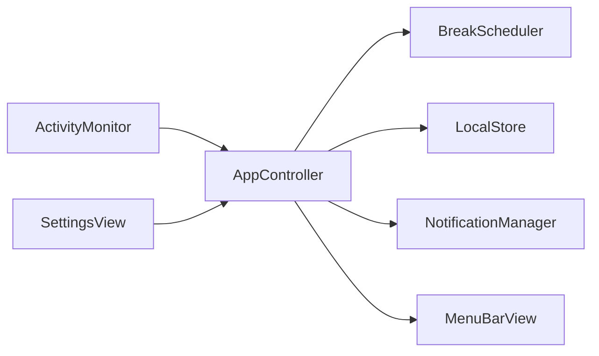

# Kıpır — Architecture

## Boundaries
`BreakScheduler` is the sole authority: Foundation only, injected monotonic seconds, date and aggregate idle seconds, no timers or permissions. `Settings` validates preferences. `LocalStore` serializes validated checkpoints and current-day totals to UserDefaults. `AppController` is main-actor isolated, owns the only heartbeat, publishes a snapshot and dispatches actions. `ActivityMonitor` reads CoreGraphics aggregate idle and lifecycle notifications. `NotificationManager` owns permission/category/delivery and rejects stale identifiers. SwiftUI renders state and calls the controller.

## State machine
Working transitions to Due at its confirmed work target; Due transitions to Break, snoozed Working, or skipped Working. Break completion returns to Working and increments the completed cycle. Pause and Meeting are orthogonal overrides that preserve phase/countdown but freeze all accounting and suppress reminders. Lifecycle suspension freezes the same state. Reset clears session/cycle but retains today's totals.

## AFK and time accounting
CoreGraphics `CGEventSource.secondsSinceLastEventType(.combinedSessionState, eventType: .init(rawValue: UInt32.max)!)` samples elapsed seconds since any event; no event taps or content are used. API availability/signature is checked by compiling against the installed SDK. Every heartbeat compares inferred last-event timestamps. Input-free spans below the AFK threshold are provisional. A new event confirms a short gap and commits it; reaching AFK or returning after a long inferred gap discards provisional time. This avoids crediting the entire threshold when someone leaves. Work/reminders use confirmed time only. Confirmed active use continues accumulating while Due, with the same episode identity; waiting to accept a break does not hide active use from daily totals. Reading without input can be undercounted.

One-second heartbeat with tolerance; elapsed monotonic deltas, not tick counts. Negative/nonfinite clocks or idle, gaps over 10 seconds, and local-day changes fail closed. Break countdowns also freeze over unknown gaps. Lifecycle events settle the previous sample before suspension, then rebaseline on resume. No offline credit on restart. Day changes reset only daily totals, preserving session work; the crossing sample is discarded to avoid assigning it to the wrong day.

## Persistence and failure handling
Checkpoint contains confirmed interval, due target, phase, remaining and original break duration, short-break cycle, pause/meeting flags and current local-day totals. No raw activity history. Save after meaningful changes and at most every 15 seconds during tracking; termination saves. A crash may lose up to 15 seconds, never add offline time. Invalid settings recover per field; malformed checkpoints are discarded. Valid persisted values are range checked before use. Settings changes apply immediately to work target (except an active snooze); current break duration stays fixed.

## Notification lifecycle
Explicit user permission request. One persisted identifier per due episode and one persisted delivery-attempt marker; pause/meeting/restart preserve the episode identity. At most one send attempt per episode, including errors; panel controls remain the fallback. notification actions carry that ID and only affect the matching current due state. Leaving visible due removes pending/delivered requests. Permission denial and delivery errors appear in Settings; the panel remains usable. Break completion is a quiet panel transition unless the separate completion-sound preference is enabled. No automatic permission retry and no timer owned by notifications.

## SDK reference
The macOS 26.2 SDK `CGEventSource.h` declares the C function returning `CFTimeInterval`; Swift imports it as the compiled class method above. Apple's [CGEventSource documentation](https://developer.apple.com/documentation/coregraphics/cgeventsource) lists the signature and [combinedSessionState](https://developer.apple.com/documentation/coregraphics/cgeventsourcestateid/combinedsessionstate) describes the current login-session event state. This is aggregate inactivity, not evidence of posture or attention.

## Exercise sequence
ExerciseDefinition and ExerciseCatalog live in Foundation. ExerciseSequenceController owns only a cursor and movement elapsed time, and receives the exact confirmed countdown delta from BreakScheduler; it owns no clock/timer. The scheduler clears it on completion/skip/reset. AppController's existing heartbeat publishes snapshots. MenuBarView embeds BreakExerciseView during onBreak; no separate break window is created. Dismissing the popover never changes scheduling; reopening renders the current sequence state.
Manual navigation resets the selected movement's timer without changing the overall break budget. The last movement fills the remaining budget; early finish or skipping the last movement uses the existing skip transition (no completed-break credit). Natural overall timeout credits exactly once through the existing scheduler. Restart rebuilds the chronological guide from persisted break elapsed time; manual navigation position is not persisted. Canvas TimelineView drives visual poses only; it never advances scheduling.

## Interface language
The shared localization helper selects the Turkish or English resource bundle from a separate local UserDefaults language preference, defaulting safely to Turkish. AppController changes the preference, refreshes notification action categories and invalidates presentation; SwiftUI receives the selected locale. Scheduling and persisted Settings/checkpoints are unaffected.

## Exercise illustrations v2
`UI/Exercises/ExerciseAnimationView.swift` owns original Canvas artwork, pose interpolation and rendering. `ExerciseVisualClock` is a small monotonic visual clock: it freezes/resumes without resetting and has no scheduling authority. When the popover opens its visual position starts from the scheduler-accepted exercise elapsed time; navigation creates a new view. TimelineView redraws only while visible and running. The scheduler remains the sole break countdown authority. Wrist illustrations mirror after the scheduler reports halfway. No bundled third-party assets or dependencies.

## Quality-of-life boundaries
`Core/QualityOfLife.swift` formats menu status, derives timing presets, shares notification-test permission policy and consumes completion feedback through a supplied playback closure. These helpers are Foundation-only. AppController still owns the sole one-second heartbeat; no extra timer, permission, network access or dependency was added. Menu label text changes only when rounded minute/state changes; native monospaced digits and a minimum text width limit resizing.

NotificationManager uses a narrow injected `NotificationDelivery` boundary, backed by the same native UNUserNotificationCenter. Test requests use `kipir.test.<UUID>`, no break category/actions/userInfo and no reminder-marker mutation or removal. Notifications' change callback invalidates presentation only; real synchronization stays in controller publishing. A separate refreshed-authorization test path reports submission/failure without claiming presentation.

Checkpoint's optional `meetingDeadline` is an absolute Date. BreakScheduler reconciles it during initialization, tick and both suspension transitions. Expiration clears only meeting/deadline, rebaselines and discards that sample; it does not reset the phase, cycle, totals or manual pause. Controller saves expiration immediately. Original indefinite meeting checkpoints still restore indefinitely.

Settings adds only `breakEndSound` (default false). Missing or malformed new preference defaults off; missing deadline preserves legacy indefinite mode, malformed deadline clears meeting only. Old UserDefaults keys remain. Finite but expired or more-than-one-hour-future deadlines clear meeting conservatively at scheduler restore/tick. Timezones/DST do not move an absolute deadline; clock-forward adjustments may expire it early, backward adjustments can delay it within the supported one-hour horizon, and larger backward jumps cancel timed mode. Work accounting continues using monotonic time.

Natural countdown completion produces an ephemeral consumable event capturing sound preference at completion, absent from persistence. Manual skip/reset/pause/meeting/suspension suppress pending feedback. Controller consumes after every scheduling publication and optionally plays native NSSound Tink at 25% application gain. It never increases system volume; restore produces no event. No bundled asset or target resource is needed for this system sound.

## Desktop notification eligibility
The native delivery boundary returns all five relevant UNNotificationSettings values through a Foundation-only NotificationCapabilities snapshot. Submission eligibility (authorized or provisional) stays separate from desktop eligibility (fully authorized, alertSetting enabled, alertStyle banner/alert). Notification Center and system sound are reported independently. Quiet authorization is never labeled fully authorized. No persisted schema or scheduler behavior changes.

The delegate is synchronously configured in NotificationManager initialization, before its asynchronous settings read; AppController's strong notification-manager property retains it for the app lifetime. Foreground delivery requests `.banner` and `.list`; `.sound` is requested only when content has sound. Request sound itself requires both app preference and system sound availability. Background presentation remains macOS-owned. Neither foreground options nor settings inspection can prove presentation or override Focus.

Settings refresh on appearance, application activation and each test. The Open Notification Settings action uses public NSWorkspace opening APIs with a best-effort pane URL and bundle query. macOS does not provide a public guaranteed per-app notification-pane navigation API here; failed URL opening falls back to opening System Settings, and manual navigation guidance remains even after accepted URL opening. No private API, preference writing, critical alert or overlay is used.
