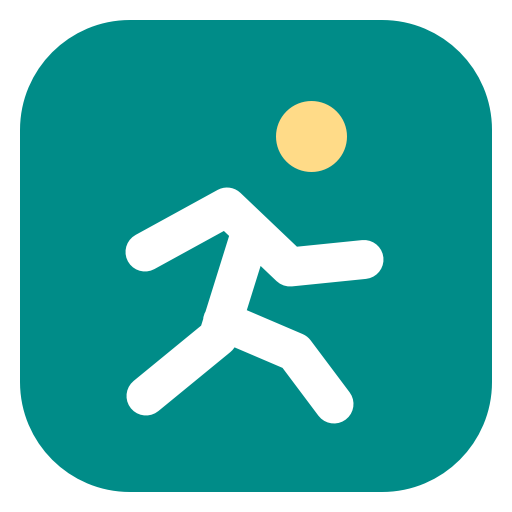
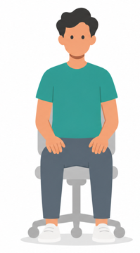
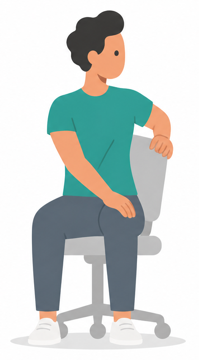
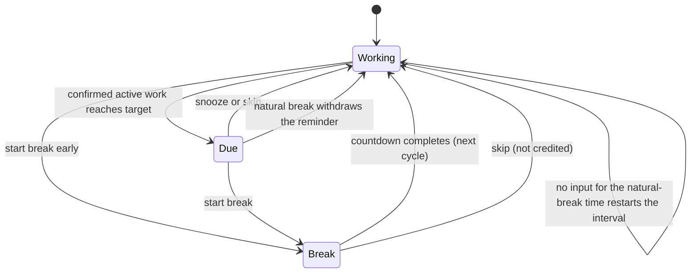

<p align="center">
  
</p>

<h1 align="center">Kıpır</h1>

<p align="center"><strong>A little movement goes a long way.</strong></p>

<p align="center">
  
  
  
</p>

Kıpır is a private movement reminder that lives in the macOS menu bar. It tracks how long you have actually been working at your Mac and, when a break is due, guides you through a short illustrated stretch right in the menu bar panel.

It is built for developers and other people who sit for long stretches and forget to move. There are no accounts, no network access, no telemetry and no productivity scores. The interface is available in Turkish and English and follows your macOS language by default (English if your language is neither).

> **Status:** Kıpır is a free preview. The release build is ad hoc signed and **not notarized by Apple**, so macOS may ask you to approve the first launch. See [Installation](#installation).

## What makes it different from a timer

- **It counts confirmed active time.** Work time is never credited while your Mac is asleep or locked, while Kıpır isn't running, or across gaps it can't account for, and idle time past a threshold is excluded.
- **It notices when you already took a break.** After a stretch with no input (10 minutes by default), the work interval restarts, so you are not reminded right after you return.
- **It does not claim you exercised.** A completed countdown is recorded as a completed break timer, never as exercise.
- **Reminders are optional.** The panel always shows when a break is due, even with notifications off.

## Preview

The movement guide shows each exercise as two poses, here the seated twist, the chest opener and the wrist stretch (start pose above, end pose below). No app screenshots are included yet.

<p>
  
  
  
</p>
<p>
  
  
  
</p>

## Features

- **Menu bar countdown.** Shows the remaining minutes (or "Break" once due) next to a state icon, or the icon alone if you prefer. The tooltip and VoiceOver always describe the full state.
- **Work and break cycle.** Defaults are 45 minutes of work, a 2-minute short break, and a 5-minute long break after 3 completed short breaks. The Settings presets are Quick Focus (25/1/5) and Balanced (45/2/5), and every value is validated.
- **Guided movements.** A break opens an illustrated, two-pose guide in the panel with instructions, a per-movement countdown, overall progress and keyboard controls (left/right arrows to move between movements, Space to pause or resume). The catalog has 11 movements across neck and shoulders, back, hands and legs, ending long breaks with a walk. Rotation is deterministic, and you can focus on one body area in Settings. With Reduce Motion enabled, the guide shows two labeled still poses.
- **Meeting Mode.** Silences reminder notifications and the break sound for 15, 30 or 60 minutes, or until you end it. The timer and breaks keep running.
- **Pause, snooze and skip.** Pause freezes the schedule. Snooze adds more active work before the next reminder. Skip restarts the interval without advancing the cycle.
- **Natural break detection.** If you step away from input for long enough (Off, 5, 10 or 15 minutes), the work interval restarts and any pending reminder is withdrawn. It is never counted as a completed break.
- **Working hours.** Optionally restrict tracking and reminders to chosen weekdays and hours, including overnight windows.
- **Notifications and sound.** Optional local notifications (clicking one opens the panel) and an optional quiet completion sound, which is off by default.
- **Everyday settings.** Light, Dark or System appearance, System Default, Türkçe or English language, and launch at login.

Today's totals (active time and completed break timers) are shown in the panel. Only the current local day is kept.

## Installation

### Homebrew

A cask is published for the latest release. It requires macOS 14 (Sonoma) or later.

```sh
brew tap omerahat/kipir https://github.com/omerahat/kipir.git
brew install --cask omerahat/kipir/kipir
open /Applications/Kipir.app
```

### Manual download

Download `Kipir-<version>.zip` (and the `.sha256` file) from the [Releases page](https://github.com/omerahat/kipir/releases), unzip it, and move `Kipir.app` to `/Applications`.

### First launch

Releases are ad hoc signed and not notarized. If macOS blocks the first launch, open **System Settings → Privacy & Security** and choose **Open Anyway**, and only do so if you trust where you downloaded the app. Managed Macs may block the app entirely, and corporate devices may need IT approval. Kıpır does not ask you to disable Gatekeeper or remove quarantine flags.

Kıpır has no Dock icon and no regular window. Look for the walking-person icon in the menu bar.

### Updating and uninstalling

Quit Kıpır first. Then update with `brew update && brew upgrade --cask omerahat/kipir/kipir`, or remove it with `brew uninstall --cask omerahat/kipir/kipir`. If you enabled launch at login, turn it off in Settings before uninstalling. Uninstalling does not delete your local preferences, and the app has no built-in updater.

## Getting started

1. **Launch Kıpır** and click the menu bar icon. A short welcome flow lets you optionally grant notification permission with an explicit button.
2. **Work as usual.** The panel shows a countdown ring, time until your next break and today's totals.
3. **When a break is due,** start it from the panel or from the notification's Start action. The movement guide begins in the same panel. You can close the panel and move away from the screen, and reopen it from the menu bar icon.
4. **Adjust things** in **Settings**: timing preset or custom values, break lengths, natural break, exercise focus, working hours, notifications, sound, appearance, language, menu bar style and launch at login.

## How it works



Pause can be applied in any state: it freezes the countdown and statistics and suppresses reminders until you resume.

- Every second a single heartbeat compares monotonic time and the system's aggregate "seconds since last input". Only confirmed active seconds count as work.
- Gaps caused by sleep, screen lock, unknown time jumps or the app not running are never credited as work or as break progress.
- Idle time up to the AFK threshold (90 seconds by default) is provisional: it is credited as work only once later input confirms it was a short pause.
- Meeting Mode only silences notifications and sounds; the timer, statistics and breaks keep running. Pause freezes the schedule and statistics.
- Only a countdown that runs to zero counts as a completed break. Skipping or finishing early does not.

## Privacy and permissions

- **No network.** The app makes no network requests, and the sandbox entitlements file contains only `com.apple.security.app-sandbox`. There are no analytics, accounts, cloud sync or third-party dependencies.
- **No content collection.** Idle detection reads only aggregate seconds since the last input through CoreGraphics. Keystrokes, mouse positions, screenshots, window titles and app names are never read.
- **Local storage.** Preferences, session progress and the current day's aggregate totals are kept in `UserDefaults` on your Mac, unencrypted. Nothing is exported.
- **Permissions.** Notifications are requested only when you press the button for it. Launch at login uses Apple's `SMAppService` and can be restricted by device policy. No Accessibility, Input Monitoring or Screen Recording permission is requested.

See [SECURITY.md](SECURITY.md) for more detail, including how to report security issues.

## Technology

- Swift with SwiftUI and AppKit, targeting macOS 14.0+, built with Xcode.
- Apple frameworks only: CoreGraphics (idle seconds), UserNotifications, ServiceManagement (login item), AppKit (`NSSound` for the completion sound).
- No third-party dependencies and no network code.
- Swift Package Manager is used only as a headless test harness for the core logic. `Kipir.xcodeproj` is the canonical project.

## Architecture

| Path | Responsibility |
|---|---|
| `Kipir/Core` | Foundation-only logic: `BreakScheduler` state machine, settings validation, exercise catalog and playback, working hours, `UserDefaults` persistence |
| `Kipir/App` | App lifecycle, activity monitor, notifications, menu bar item and the controller that owns the one heartbeat timer |
| `Kipir/UI` | SwiftUI views: popover, settings, onboarding, countdown ring, exercise animation |
| `Kipir/Resources` | Asset catalog (app icon, exercise artwork) and Turkish/English string tables |
| `KipirTests` | XCTest suite for the core, run through both Xcode and SwiftPM |
| `Scripts` | Icon and asset generation, release packaging, Developer ID/notarization script, localization and script checks |
| `Casks` | Homebrew cask |

The scheduler never imports AppKit or SwiftUI, owns no timers and requests no permissions. All time (monotonic clock, wall date and idle seconds) is injected, which keeps timing behavior deterministic in tests. For the details, see [ARCHITECTURE.md](ARCHITECTURE.md), [DESIGN.md](DESIGN.md) and [DECISIONS.md](DECISIONS.md).

## Development

Requires macOS 14+, Xcode with the macOS SDK, and Swift 5.9+. There are no packages to install.

```sh
git clone https://github.com/omerahat/kipir.git
cd kipir
open Kipir.xcodeproj
```

Select the **Kipir** scheme and **My Mac**, then Run. Keep code signing enabled for local runs, because a build with `CODE_SIGNING_ALLOWED=NO` cannot register for notifications. The bundle identifier and version live in `Config.xcconfig`.

Command-line build and tests:

```sh
swift test
xcodebuild -project Kipir.xcodeproj -scheme Kipir -configuration Debug -derivedDataPath build build
xcodebuild -project Kipir.xcodeproj -scheme Kipir -configuration Debug -derivedDataPath build \
  CODE_SIGN_IDENTITY=- CODE_SIGN_STYLE=Manual CODE_SIGNING_ALLOWED=YES test
python3 Scripts/test-localization.py
```

Build a release archive for Intel and Apple Silicon with `bash Scripts/package-release.sh`. It writes a ZIP, a checksum and a cask to `dist/`. Publishing, signing identities and notarization are maintainer-only steps documented in [DISTRIBUTION.md](DISTRIBUTION.md), which is written in Turkish. [TESTING.md](TESTING.md) records test results and the device checks that are still pending.

## Limitations

- Idle time is a proxy: reading without touching the keyboard or mouse is not counted as work.
- Natural break and working hours are conservative heuristics, not proof of rest or of a work schedule.
- Notification authorization does not guarantee visible banners. Focus modes and macOS notification settings can suppress them.
- Real-device acceptance of sleep and wake, notification delivery, accessibility and a human review of the exercise illustrations are still pending, as recorded in [TESTING.md](TESTING.md).
- Intel hardware and macOS 14 runtime behavior have not been verified.

## Contributing

Contributions are welcome. **The exercise animations need help most:** each movement is currently two still poses with a crossfade. If you draw or animate, see [CONTRIBUTING.md](CONTRIBUTING.md) for how the artwork pipeline works, its known problems and its constraints. The same guide covers code changes: no network, telemetry or third-party dependencies, Turkish and English strings for every visible message, and tests for behavior changes.

## License

Kıpır is released under the [MIT License](LICENSE).
