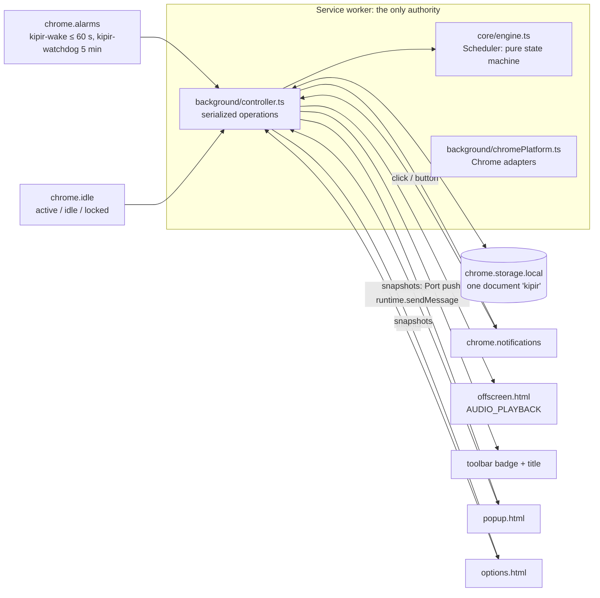

# Architecture

## Overview

| Path | Responsibility |
|---|---|
| `src/core/engine.ts` | Port of `BreakScheduler`: phases, cycle, pause, meeting, natural break, working hours, day rollover, validation and restore. Pure: time and ids are injected. |
| `src/core/settings.ts` | Port of `Settings`/`WorkingHours` validation, presets and editing helpers. |
| `src/core/exercises.ts` | Port of the exercise catalog, rotation, cursor and pose blend. |
| `src/core/presentation.ts` | Badge, status notes, transient notice, notification plan and language resolution. |
| `src/core/model.ts` | Persisted document, lenient loader, read-only `Snapshot`, and the view projection. |
| `src/background/controller.ts` | One queue; each operation is load → engine step → plan → commit → effects → badge → wake → broadcast. |
| `src/background/chromePlatform.ts` | Chrome API adapters behind the `Platform` interface (fakes in tests). |
| `src/background/index.ts` | Top-level listener registration (required for MV3 wake-ups). |
| `src/offscreen/offscreen.ts` | Synthesized sounds; closes itself after playing. |
| `src/ui/**` | React views (popup, options) rendering snapshots; no timer authority. |
| `src/i18n/**` | Runtime dictionary: native `Localizable.strings` parsed at build time, plus browser-specific overrides. |
| `scripts/native.ts` | Vite plugin that reads the native strings and copies the 22 exercise PNGs from `Kipir/Resources` into the build. |

## Why event sampling instead of a heartbeat

The native app samples once per second. An MV3 service worker is suspended after about 30 s of inactivity, and `setInterval` dies with it, so the extension never uses `setInterval` for time. Instead:

1. **Every input samples the engine** with `now` (wall-clock seconds): wake alarms, `chrome.idle.onStateChanged`, popup/options intents, notification buttons, and the worker's own start-up.
2. **Credit for (previous sample, now]** follows the activity that held during the interval. Activity only changes through idle events, so it is piecewise constant between samples. Every operation also re-queries `chrome.idle.queryState`, so a missed event is corrected within one heartbeat.
3. **Gaps fail closed.** The controller always schedules the next wake ≤ 60 s ahead (`HEARTBEAT`). An interval longer than 150 s (`GAP_LIMIT`), or a backward clock, is unknown time and earns nothing: sleep, a closed browser, a frozen process or a clock change.
4. **Precise wakes.** `Scheduler.nextWake(now)` returns the earliest of: the Due boundary, the break end, the next badge-minute change, a meeting deadline, the natural-break threshold and the heartbeat. A single one-shot alarm `kipir-wake` is re-created after every operation; a 5-minute periodic `kipir-watchdog` restarts the chain if it is ever lost. Both are re-created at start-up because alarm persistence is not guaranteed before Chrome 150.
5. **Provisional idle tail.** `chrome.idle` reports `idle` once no input has happened for `afk` seconds, so the last input was `afk` seconds earlier. The credit given since the last confirmed input (`runCredit`, reset by every user action) is retracted, up to `afk`. Natively that tail is never credited; here it is credited, then taken back.

### Idempotency and duplicates

- A repeated sample at the same instant is a no-op (`prev === now`), so duplicate or concurrent alarms cannot double-count.
- All operations run through one promise queue, so popup clicks, alarms and idle events never interleave.
- Notifications follow the native at-most-once rule: `planNotifications` writes `lastAttempted = dueId` into the **same document**, and that document is committed **before** `chrome.notifications.create`. A worker killed between the two can lose a reminder but never duplicate one. Meeting mode marks the current episode as attempted, so ending a meeting never replays it.
- Notification buttons act only when their id equals the current `reminderId`.
- Completion and natural-break events are ephemeral (never persisted), so a restore never replays a sound or notice.

### Lifecycle policy

| Event | Behavior |
|---|---|
| Popup opens or closes | The popup connects a `Port` and sends `sync`; closing it changes nothing. |
| Service worker suspended or restarted | State is in storage; the next event loads it and samples; no time lost (verified with a real CDP worker stop). |
| Computer sleeps and wakes | Missed alarms fire on wake; a gap over `GAP_LIMIT` is not credited. A `locked` state during sleep counts as away time for the natural break. An unlocked sleep shorter than about 150 s minus the time since the last sample cannot be told apart from activity and is credited. |
| Chrome quit and reopened | The first operation of a new browser session sees no `kipir-session` marker in `chrome.storage.session` (Chrome clears it on browser restart) and calls `restart`. The state is restored, the away chain tainted and nothing credited for the closed period, however short. The Due episode and its identity survive. This does not depend on whether `onStartup` or another event woke the worker first. |
| Install, update or reload | The session marker is cleared too, so the same restart applies. `onInstalled` and `onStartup` also ensure the watchdog. |
| Wall-clock change | Backward: rebaseline without credit (a timed meeting cancels if beyond its 1 h horizon). Forward: looks like a gap, not credited. Daily totals follow the local date. |

## Views

Views are projections. `useKipir` holds the latest `Snapshot` and the `performance.now()` at which it arrived. `project(snapshot, elapsed)` advances only quantities whose rate is 1 (the countdown while running, active work while accruing), so a paused or idle timer never moves visually. When the projection reaches a boundary, the view asks the background to `sync`; the background remains the authority. Every committed change is pushed to all connected views, so two popups and the options page stay consistent.

Layout stability (DECISIONS 031) is structural: nothing above the primary row changes size with state, the two primary buttons share the row equally, and notes and meeting details render below their controls. Real-browser tests compare bounding boxes before and after pause, resume and meeting toggles, and measure every state against Chrome's 600 px popup height.

## Storage

`chrome.storage.local["kipir"]` holds one document (`schema: 1`):

- `settings`: validated preferences (native `Settings`, same keys and units).
- `engine.checkpoint`: native `Checkpoint` (active work, target, phase, break remaining/duration, cycle, pause, meeting and deadline, snooze, due id, today's totals, exercise rotation and focus, off-hours flag) plus the exercise cursor.
- `engine.runtime`: sampling bookkeeping (last sample time, activity, window flag, retractable credit, natural-break chain).
- `notify`: the last attempted and the visible reminder ids.
- `notice`: the pending or visible transient notice.
- `prefs`: language preference and the onboarding flag.

`loadPersisted` validates field by field; a corrupted checkpoint falls back to a fresh session without touching valid settings. `localStorage["kipir.appearance"]` mirrors the appearance only to paint the next popup in the right theme. `chrome.storage.session` holds only the `kipir-session` marker (and, in the e2e build, the debug clock offset).

## Permissions

`storage`, `alarms`, `notifications`, `idle`, `offscreen`. No host permissions, content scripts, `tabs`, `scripting` or remote code. The `windows` and `action` APIs used for the notification-click fallback need no permission.

## Build

Vite 8 multi-entry build (`popup.html`, `options.html`, `offscreen.html` and `background/index.ts` as an ES-module service worker). WXT and CRXJS were considered; a plain Vite config was enough for four entries and keeps the manifest a hand-written, reviewable file. The `e2e` mode adds a debug message (clock offset and forced idle state) behind `import.meta.env.MODE === 'e2e'`, which is compiled out of production builds; `scripts/package.mjs` fails the release if it is ever found.
